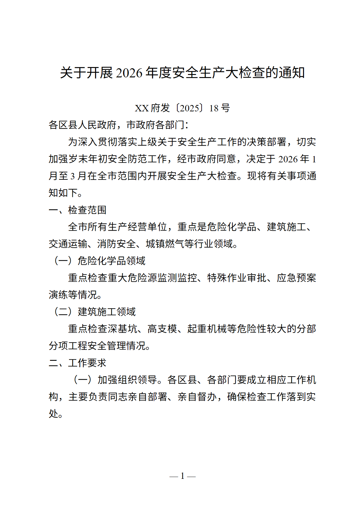

# 排版工作台 · Format Studio

> 把一篇没有格式的中文文字，一键整理成**党政机关公文**、**学术论文**、**工作总结**……并直接生成排好版的 `.docx`。
>
> 自带排版引擎，不调用 Word / WPS / Office，不联网，不消耗大模型 token。


同一套引擎生成的公文页（GB/T 9704-2012 版式，正文三号仿宋、固定行距 28 磅、首行缩进两字符、页码「— 1 —」）：



---

## 它解决什么问题

网上复制来的材料、手写的汇报、AI 生成的初稿，往往只有段落文字：标题不居中、没有层级、首行不缩进、行距混乱。
手工在 Word 里逐条改样式，一篇几千字的材料要折腾十几分钟，还容易改漏。

排版工作台做三件事：

1. **识别结构**：标题、副标题、作者、单位、发文字号、摘要、关键词、主送机关、`一、` / `（一）` / `1.` / `（1）` / `第X章` 各级标题、参考文献、落款、成文日期；
2. **套用版式**：页面尺寸、页边距、字体字号、行距、缩进、对齐、页码、落款位置；
3. **输出文件**：直接写出 `.docx`，任何 Word / WPS 都能打开继续改。

**文字一个字都不改**，只调整结构与版式。

---

## 支持的格式

| id | 名称 | 关键参数 |
| --- | --- | --- |
| `gov` | 党政机关公文 | GB/T 9704-2012：版心 156×225mm，页边距 37/35/28/26mm，标题二号小标宋居中，正文三号仿宋_GB2312，固定行距 28 磅，首行缩进 2 字符，一级标题黑体 / 二级楷体 / 三级仿宋加粗，页码四号宋体「— 1 —」 |
| `paper` | 学术论文 | A4，正文宋体小四、1.5 倍行距、首行缩进 2 字符；摘要关键词五号；标题黑体二号；参考文献五号悬挂缩进 |
| `thesis` | 学位论文 | 宋体小四 1.5 倍行距；章标题黑体三号居中并另起一页；节标题黑体四号；参考文献另起一页 |
| `report` | 工作总结 / 汇报 | 标题二号小标宋居中，正文三号仿宋 1.5 倍行距，落款右对齐 |
| `news` | 新闻稿 / 通讯 | 标题黑体小二号居中，记者署名楷体居中，正文宋体小四 1.5 倍行距 |
| `business` | 商业报告 / 方案 | 标题黑体二号，一级标题黑体小三、二级四号、三级小四加粗 |
| `letter` | 申请 / 信函 | 标题黑体三号居中，称呼顶格，正文三号仿宋，署名与日期右对齐 |
| `resume` | 简历 / 个人材料 | 紧凑排版：宋体五号、1.25 倍行距、栏目名黑体加下划线隔断 |
| `auto` | 自动匹配 | 按「应用场景」关键词匹配：`请示/通知/纪要…`→公文，`毕业论文/答辩…`→学位论文，`论文/摘要/参考文献…`→学术论文，`总结/述职…`→总结，`方案/可行性…`→商业方案…… |

拿不准结构时，可以用 Markdown 式标记手动指定：`# 标题`、`## 一级`、`### 二级`、`#### 三级`，以及 `---` 分页。

---

## 两种运行形态，同一套引擎

| 形态 | 位置 | 适合 |
| --- | --- | --- |
| **独立小程序（Windows）** | `desktop/` → 编译出单个 `.exe`，约 90 KB | 双击即用，任何人拿到就能用 |
| **浏览器面板** | `index.js` + `client.js`（DeepSeek Harness 插件） | 在对话框里直接排版，生成后浏览器下载 |

`test/compare_docx.py` 会把两种形态的输出逐段比对：页面尺寸、页边距、每段的字体、字号、加粗、对齐、首行缩进、段前段后、行距——**8 个预设全部 identical**。

---

## 快速开始

### 方式一：直接运行 Windows 小程序

1. 从仓库的 `desktop/` 目录编译（见下），或直接下载 Release 里的 `FormatStudio.exe`；
2. 双击打开 → 选「目标格式」（或「自动匹配」）→ 粘贴全文；
3. 点「生成 Word 文档」→ 选保存位置 → 完成。

输入框旁边还有：`查看识别结构`（先核对它把哪些行认成标题）、`复制排版文本`（带首行缩进的纯文本）、`填入示例`、`Ctrl+Enter` 直接生成。

### 方式二：作为 DeepSeek Harness 插件

仓库根目录本身就是一个可安装的 Cordis bundle：

```powershell
# 在你的 DSH profile 里安装本目录
# （通过 plugin_manager 的 install_bundle，或让 AI 助手用 plugin_manager 工具安装）
```

安装后，对话输入框上方会出现「排版工作台」横条，粘贴 → 选格式 → 生成。宿主侧同时注册了 `format_document` 工具，AI 也能直接调用。

### 方式三：命令行

```
FormatStudio.exe --cli --input in.txt --preset gov --out out.docx
FormatStudio.exe --cli --input in.txt --preset auto --scenario "写给市政府的请示" --out out.docx
FormatStudio.exe --selftest out-dir        # 给 8 个预设各生成一份样张
```

---

## 构建

### 浏览器插件半

```powershell
node build.mjs        # 由 src/*.mjs 生成自包含的 client.js
```

### 独立 exe（零依赖）

只需要 Windows 自带的 .NET Framework 4.x（Win10/11 预装），用系统里的 `csc.exe` 编译，**不需要 SDK、NuGet、任何运行时包**：

```powershell
powershell -ExecutionPolicy Bypass -File desktop\build.ps1
# 产物：dist\FormatStudio.exe
```

图标也由脚本生成（System.Drawing 画图 + 手写 ICO 容器，7 个尺寸）：

```powershell
powershell -ExecutionPolicy Bypass -File desktop\make-icon.ps1
```

---

## 架构

```
src/                 纯 JavaScript 排版引擎（零依赖，浏览器与 Node 通用）
├── presets.mjs      8 套格式的版式参数（页面、字号、行距、缩进、页脚）
├── parser.mjs       文本 → 语义块（段落归并、标题识别、落款/日期识别）
├── layout.mjs       语义块 + 预设 → 渲染中立的文档模型
├── docx.mjs         OOXML 生成 + 手写 ZIP（STORE 压缩，含 CRC32）
├── toolspec.mjs     工具 schema 转换（紧凑写法 → 标准 JSON Schema）
└── engine.mjs       对外的 formatDocument() 门面

index.js             插件宿主半：注册 format_document 工具，写文件到会话工作目录
client.js            插件浏览器半（build.mjs 生成）：输入框上方的排版面板
desktop/             独立小程序（C# 5 / WinForms，逐行移植自 src/*.mjs）
├── Model.cs         样式与文档模型
├── Presets.cs       8 套版式（与 presets.mjs 数值一一对应）
├── Parser.cs        结构识别
├── Layout.cs        版式装配
├── Docx.cs          OOXML 生成 + 手写 ZIP
├── Program.cs       入口：GUI / --cli / --selftest
└── MainForm.cs      主窗口
```

数据流：

```
原始文字 ──▶ Parser（结构识别）──▶ Block[]
                                   │
          Preset（版式参数）──────▶ Layouter（装配）
                                   │
                                   ▼
                        Paragraph[]{样式 + 文本}
                                   │
                    ┌──────────────┴───────────────┐
                    ▼                              ▼
        Docx.Generate（.docx bytes）      面板预览 / 纯文本
```

---

## 测试与验证

| 脚本 | 检查内容 |
| --- | --- |
| `node test/validate.mjs` | 8 个预设全部生成 `.docx`，打印识别结构 |
| `python test/check_docx.py` | 用 python-docx 读回：页面尺寸、页边距、字体、字号、行距、首行缩进、页码域 |
| `python test/compare_docx.py` | **浏览器版 vs exe 版**逐段比对，8/8 identical |
| `node test/client-smoke.mjs` | 用 React/DOM 桩件驱动浏览器面板：展开、生成、复制、交接 AI |
| `node test/host-smoke.mjs` | 用 Cordis 桩件驱动宿主工具：schema 校验、落盘、返回值 |
| `test/capture-window.ps1` | 启动 exe 并用 `PrintWindow` 截图，用于界面自检 |

排版结果还会用 LibreOffice 渲染成图片逐页目视检查（页边距、版心、缩进、行距、页码是否落在正确位置）。

---

## 技术点

- **自己写 `.docx`**：不依赖 `docx`、`python-docx`、LibreOffice。OOXML 的 `document.xml` / `styles.xml` / `settings.xml` / `footer1.xml`（含 `PAGE` 域）全部手写；包容器是手写的 ZIP（STORE 方式，含 CRC32 表），所以同一份 JS 能在浏览器和 Node 里跑。
- **真正的双运行时**：同一套规则被移植成 C# 5 / WinForms，编译产物 90 KB，无运行时依赖；比对脚本保证两份实现不漂移。
- **确定性排版**：不调用大模型，同样的输入永远得到同样的输出，几万字也是毫秒级。
- **中文排版细节**：`firstLineChars`（首行缩进按字符而非磅）、`lineRule="exact"`（固定行距）、`eastAsia` 字体槽、`docGrid` 关闭、页码字段——这些是「看起来对」和「真的对」的区别。
- **结构识别是启发式但可干预**：优先规则（编号、摘要、落款），其次启发式（短行、无标点、后接长段），还可以用 `#` 手工指定。

---

## 已知限制

- 公文标准字体 `方正小标宋简体` / `仿宋_GB2312` / `楷体_GB2312` 若本机未安装，Word / WPS 会自动替换为相近字体，字号、行距、缩进、页边距不受影响。
- 输入是纯文本；不解析 `.docx` / `.pdf` 输入（Word 里的内容请复制正文后粘贴）。
- 表格、图片、公式暂不参与排版（正文段落按顺序输出）。

---

## License

MIT
